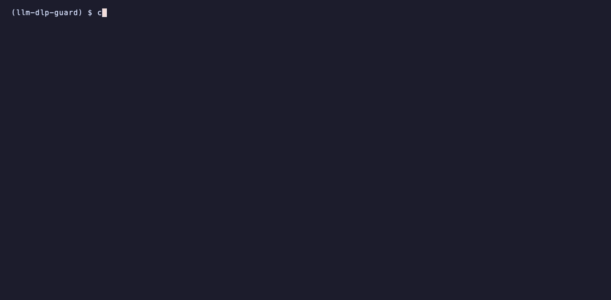

<h1 align="center">LLM DLP Guard</h1>

<p align="center">
  <em>Data loss prevention for LLM traffic: finds PII, secrets and credentials in prompts and answers, and blocks, redacts or reversibly tokenizes them, including inside token streams.</em>
</p>

<p align="center">
  <a href="https://github.com/adeoluo/llm-dlp-guard/actions/workflows/ci.yml"></a>
  <a href="https://github.com/adeoluo/llm-dlp-guard/releases"></a>
  
  
  <a href="LICENSE"></a>
</p>

---

## Motivation

Prompts sent to hosted models routinely carry customer names, card numbers and pasted
configuration with live API keys, and model answers can echo them back into logs and chat
histories. A guard in that path has three jobs that pull in different directions: catch
structured secrets with almost no false alarms, catch free-form PII (names, streets, cities) that
no regular expression describes, and do it fast enough to sit inline, token by token, on a
streamed answer.

This project does all three in one package. A Rust core runs an Aho-Corasick prefilter, 29
bounded patterns with checksum and structure validators, and a linear-chain CRF tagger trained
here on the full ai4privacy/pii-masking-400k training split. A policy engine decides per label
and direction whether to allow, mask, hash, redact, block or tokenize; tokens are
format-preserving and reversible through a per-request vault, so the provider never sees the
real values and the user still gets an answer that mentions them. Streaming redaction is exact:
for any chunking, the stream output equals redacting the whole text at once.

## Architecture

<p align="center">
  
</p>

<sub>Legend: amber = entry points and external systems, indigo = core logic, green = data and state, blue = validation and control, grey = observability and outputs.</sub>

Text enters through the CLI, the library or the OpenAI-compatible proxy. The Rust detector finds
anchor keywords with Aho-Corasick, runs only the patterns whose anchors occur, keeps matches that
pass their validators (Luhn, IBAN mod 97, IP ranges, JWT structure, GitHub token checksums,
entropy), adds CRF tagger spans that do not overlap a validated match, and resolves overlaps by
priority. The policy maps each finding to an action; tokenized values go into the request's vault
and are restored in the answer, while secrets stay redacted in both directions. For SSE answers a
stream gate holds back only the characters that could still belong to a match. Decisions feed
Prometheus metrics, and the benchmarks score the same code paths. More detail is in
[docs/ARCHITECTURE.md](docs/ARCHITECTURE.md).

## Results

All numbers come from full runs on an Apple M1 (8 cores, 8 GB) shared with other jobs, with raw
results in [benchmarks/results/](benchmarks/results/) and the method in
[docs/EVALUATION_REPORT.md](docs/EVALUATION_REPORT.md). Intervals are 95% percentile bootstrap
intervals over documents (1,000 resamples) unless stated otherwise.

### PII on ai4privacy (held-out validation split)

Entity-level exact match (same start, end and label) on all 81,379 validation records (six
languages, 88,810 entities, 12.1 M characters). The tagger was trained on all 325,517 training
records after a learning-rate and epoch grid on a dev split carved from train.
Reproduce: `make train` and `make bench-ablation`.

| System | Precision | Recall | Micro F1 (95% CI) | Macro F1 |
|---|---:|---:|---:|---:|
| Patterns + tagger (default) | 0.911 | 0.839 | **0.874** (0.872 to 0.876) | 0.864 |
| Tagger only | 0.927 | 0.841 | 0.882 (0.880 to 0.884) | 0.877 |
| Patterns only | 0.828 | 0.429 | 0.565 (0.559 to 0.572) | 0.323 |
| Patterns + tagger, validators off | 0.876 | 0.840 | 0.858 (0.856 to 0.860) | n/a |

The tagger alone scores slightly higher than the default combination on this split (paired F1
difference 0.008 to 0.009) because ai4privacy labels some strings that fail a checksum (for
example card numbers) as entities; the default keeps validated patterns in front because they
are what holds precision on secrets and on out-of-distribution text. Turning the validators off
costs 0.016 F1 (paired interval 0.015 to 0.016). Per-language F1 for the default ranges from
0.835 (English) and 0.840 (Dutch) to 0.897 (Spanish, French). Weakest labels: credit card
(precision 0.615), surname (recall 0.651), account number (recall 0.668).

### PII against Microsoft Presidio

Same texts for both systems, labels mapped to 13 shared coarse types, Presidio 2.2 with its
default recognizers and spaCy `en_core_web_lg`. ai4privacy is the distribution the tagger was
trained on, so the Nemotron-PII rows (a different generator and annotation scheme, never used for
training or tuning) are the fairer comparison. Reproduce: `make bench-compare`.

| Data | System | Precision | Recall | Exact F1 (95% CI) | Overlap F1 | Result |
|---|---|---:|---:|---:|---:|---|
| ai4privacy English, 17,046 records | llm-dlp-guard | 0.915 | 0.813 | **0.861** (0.857 to 0.865) | 0.872 | win |
| | Presidio 2.2 | 0.262 | 0.366 | 0.305 (0.299 to 0.311) | 0.348 | |
| Nemotron-PII test, 5,000 seeded docs | llm-dlp-guard | 0.677 | 0.550 | **0.607** (0.597 to 0.616) | 0.684 | win, small |
| | Presidio 2.2 | 0.577 | **0.595** | 0.586 (0.577 to 0.596) | 0.669 | higher recall |
| Nemotron-PII test, all 100,000 docs | llm-dlp-guard | 0.680 | 0.548 | 0.607 | 0.687 | (Presidio not run at this size) |

On Nemotron-PII the paired bootstrap F1 difference is 0.010 to 0.033 exact and 0.005 to 0.027
overlap in favour of this package; Presidio has the higher recall. Presidio ran at 0.02 MB/s on
this machine against 1.4 to 1.8 MB/s for the tagger path here.

### Secrets

A seeded corpus of 46,000 secrets in 21 credential formats (random values, real formats) inside
env files, YAML, JSON, code, shell and logs, plus 46,000 hard negatives (UUIDs, hashes, base64
blobs, look-alike prefixes, placeholders), 10.5 M characters per seed; three seeds. Intervals
are Wilson intervals on seed 0. Reproduce: `make bench-secrets`.

| Scanner | Recall (95% CI) | Precision | False alarms on negatives | Label accuracy | Seconds |
|---|---:|---:|---:|---:|---:|
| llm-dlp-guard | **0.9994** (0.9991 to 0.9996) | **1.000** | **0.0%** | 0.9994 | 0.44 |
| llm-dlp-guard, validators off | 1.000 | 0.819 | 22.2% | 1.000 | 0.46 |
| detect-secrets 1.5, files as `.yaml` | 0.657 | 0.921 | 7.3% | n/a | 30.9 |
| detect-secrets 1.5, files as `.txt` | 0.534 | 0.944 | 3.6% | n/a | 33.1 |

The corpus is generated by this repository, so the formats it covers are formats the catalog
knows; read the first row as "the catalog and validators work as specified", and the
validators-off row as the measured value of the validators. Seeds 1 and 2 agree to within 0.003.
On the 17,508 Nemotron-PII documents with and without an annotated API key or password (realistic
context, many keys in formats without a fixed prefix), recall drops for every scanner:
llm-dlp-guard 0.189 at precision 0.809, detect-secrets 0.175 (`.yaml`) and 0.071 (`.txt`).

### Throughput

101,378 documents (the 81,379 ai4privacy validation records interleaved with 20,000 generated
secrets documents, 14.6 MB), scanned one document at a time unless marked batch. Rust rows are
the median of three full passes with the slowest and fastest pass in brackets; the slow engines
ran on the first 3,000 documents (Presidio on the 1,500 ASCII ones). The machine was heavily
shared during this run (load average 18 when the file was written), so read the ratios rather
than the absolute values. Reproduce: `make bench-throughput`.

| Engine | MB/s (min to max) | vs Presidio |
|---|---:|---:|
| Patterns, Rust, batch on 8 threads | **35.7** (19.9 to 40.1) | win |
| Patterns, Rust, 1 thread | 11.0 (7.7 to 11.8) | win |
| Patterns + tagger, Rust, batch on 8 threads | 3.89 (3.75 to 4.04) | win |
| Patterns + tagger, Rust, 1 thread | 0.73 (0.35 to 0.94) | win |
| Patterns, Python reference (parity only) | 1.89 | win |
| detect-secrets 1.5 line scan | 0.195 | |
| Presidio 2.2 analyze (`en_core_web_lg`) | 0.004 | |

Batch throughput with 1, 2, 4 and 8 threads: 10.0, 12.1, 15.5 and 39.3 MB/s for patterns, 0.76,
1.15, 1.89 and 2.35 MB/s with the tagger. Joining the same text into larger documents lowers
single-thread pattern throughput from 11.9 MB/s at 1 KB to 4.8 MB/s at 4 MB. The stream redactor
(patterns, 4-character chunks) adds a median 0.010 ms per chunk (p99 0.084 ms) and never holds
back more than 384 characters; with the tagger the median is 0.37 ms per chunk. Presidio's rate
here is lower than the 0.018 to 0.022 MB/s it reached on PII-only text in the comparison above,
because this mix includes the long secret strings. Peak memory 496 MB.

## Quickstart

Requires Python 3.11 or 3.12, [uv](https://docs.astral.sh/uv/) and a Rust toolchain (the core
compiles during install; prebuilt wheels for macOS arm64 are attached to the
[releases](https://github.com/adeoluo/llm-dlp-guard/releases)).

```bash
git clone https://github.com/adeoluo/llm-dlp-guard && cd llm-dlp-guard
make setup                                   # uv sync, compiles the Rust core
echo "card 4111 1111 1111 1111, mail ana@example.org" | uv run python -m llm_dlp_guard redact
```

Patterns work without any model. For names and addresses, download the data and train the
tagger, then pass `--model`. `make train` runs the small tuning grid and the final training on
all 325,517 records (about 17 minutes in total, peak memory 650 MB on the M1):

```bash
make data && make train                      # writes ../.bench-data/llm-dlp-guard/models/tagger.crf
uv run python -m llm_dlp_guard scan prompt.txt --model ../.bench-data/llm-dlp-guard/models/tagger.crf
```

## Usage

### CLI

```bash
python -m llm_dlp_guard scan FILE [--json] [--model M] [--policy P]    # list findings (values masked)
python -m llm_dlp_guard redact FILE [--direction prompt|response]       # apply the policy
python -m llm_dlp_guard stream FILE --chunk 4                           # redact as a token stream
python -m llm_dlp_guard serve --upstream https://api.openai.com         # HTTP service and proxy
python -m llm_dlp_guard catalog                                         # built-in patterns
python -m llm_dlp_guard gen-secrets --positives 1000 --negatives 1000   # labelled fake-secrets corpus
python -m llm_dlp_guard train-tagger --data DIR --out tagger.crf        # train the CRF
```

### Library

```python
from llm_dlp_guard import Guard, Policy, Tagger, Vault, redact_stream

guard = Guard(Policy.load("policy.yaml"), Tagger.load("tagger.crf"))
vault = Vault()  # one per conversation
prompt = guard.process(user_text, "prompt", vault)
if prompt.outcome == "block":
    raise PermissionError([a.finding.label for a in prompt.blocked])
answer = call_model(prompt.text)  # the provider sees tokens, not values
print(guard.process(answer, "response", vault).text)  # tokens restored, secrets stay redacted

for piece in redact_stream(guard, token_iterator, "response", vault):
    print(piece, end="")
```

### Policy

Rules are ordered and the first match wins; actions are `allow`, `mask`, `hash`, `redact`,
`tokenize` and `block`. The default blocks private keys, redacts other secrets in both directions, tokenizes PII in prompts and lets PII through in answers (so tokens can be restored).

```yaml
min_score: 0.5
default_action: tokenize
rules:
  - labels: [PRIVATE_KEY]
    action: block
  - categories: [secret]
    action: redact
  - categories: [pii]
    directions: [response]
    action: allow
allow_values: [support@example.com]
custom_patterns:
  - {name: employee_id, label: EMPLOYEE_ID, regex: "EMP-[0-9]{6}", anchors: ["EMP-"]}
```

### HTTP service and proxy

`serve` exposes `POST /v1/chat/completions` (OpenAI-compatible, JSON and SSE, forwarded to
`--upstream`), `POST /v1/scan`, `POST /v1/redact`, `GET /health`, `GET /ready` and
`GET /metrics` (Prometheus text: requests, latency, findings by label and action, blocks,
upstream errors). A blocked prompt returns HTTP 400 with a `dlp_policy_violation` error and never
reaches the provider. `python -m llm_dlp_guard mock-llm` starts a local echo model for trying the
proxy without a provider; `docker compose up` runs the service in a container.

### Demos

Recorded from real runs with [vhs](https://github.com/charmbracelet/vhs); each tape is in `docs/demo/`.
The person is fictional and the credentials are random values in real formats.

Scanning a prompt with patterns and the tagger, then redacting it with format-preserving tokens.

<p align="center">
  
</p>

The proxy in front of a local model: the provider sees tokens, the user gets real values back, a private key is blocked, and the metrics count it all.

<p align="center">
  
</p>

Streaming redaction: raw SSE events, the redacted and restored stream through the proxy, and the CLI stream redactor.

<p align="center">
  
</p>

## Design decisions

- **Rust core, Python reference.** Matching, validation and the CRF run in Rust through PyO3; a
  readable Python implementation of the same algorithms exists only for parity tests
  ([ADR-0002](docs/adr/0002-rust-core-with-python-reference.md)).
- **Prefilter, bounded patterns, validators.** Every pattern has literal anchors for one
  Aho-Corasick pass and bounded repetitions; checksums and structure checks carry precision
  ([ADR-0003](docs/adr/0003-prefilter-patterns-and-validators.md)).
- **A CRF, not a transformer.** A linear-chain CRF over 19 hashed features trains on the full
  325k-record split in under 4 minutes on a CPU and tags at about 0.7 MB/s on one core of the shared M1
  ([ADR-0004](docs/adr/0004-crf-tagger.md)).
- **Reversible, format-preserving tokens.** Tokens keep the shape of the value (a card stays a
  Luhn-valid card number, an email stays an email) and are keyed per request
  ([ADR-0005](docs/adr/0005-format-preserving-vault.md)).
- **Exact streaming.** The stream gate releases text only when no match can still cross the cut,
  so streamed output equals whole-text output for any chunking
  ([ADR-0006](docs/adr/0006-exact-streaming.md)).
- **Evaluation protocol.** Exact entity match, document-level bootstrap, paired intervals and
  reference tools on identical texts ([ADR-0007](docs/adr/0007-evaluation-protocol.md)).

## Testing

```bash
make test          # 218 Python tests
make coverage      # with the 80% gate (currently 97%)
make rust-check    # cargo fmt, clippy and 18 Rust unit tests
make parity        # Rust against the Python reference
```

The suite covers validators on known valid and invalid values (Luhn, IBAN, IP ranges, JWT,
GitHub checksums, RFC 5321 email limits); property-based tests with hypothesis (stream output
equals whole-text output for random chunkings and directions, vault round trips, card tokens
that stay Luhn-valid, constructed IBANs that validate); Rust and Python parity on random text for
pattern candidates and character offsets, tokenization, CRF features, Viterbi paths and the
negative log-likelihood (also checked against brute force on tiny lattices); positive and
negative cases for every pattern, overlap resolution, deterministic training; and integration
of the CLI, the HTTP service and the proxy against the local echo model, including SSE streams
and oversized bodies. CI runs lint, mypy and tests
on Python 3.11 and 3.12, the Rust checks and parity, and a package and image build.

## Responsible AI

- **Model card:** [docs/MODEL_CARD.md](docs/MODEL_CARD.md) (the CRF tagger and the system).
- **Data card:** [docs/DATA_CARD.md](docs/DATA_CARD.md) (ai4privacy, Nemotron-PII, generated secrets).
- **Threat model:** [docs/THREAT_MODEL.md](docs/THREAT_MODEL.md) (evasion, vault exposure, denial of service).
- All evaluation data is synthetic or generated; no real person's data and no live credential is
  used or committed. Detection is probabilistic and is not a compliance guarantee.

## Limitations

- The tagger is trained on synthetic ai4privacy text; on Nemotron-PII its exact F1 falls from
  0.874 to 0.607, and recall is lowest for surnames, account numbers and building numbers.
- Secret recall depends on the catalog: keys without a known prefix or structure are found only
  through context words (`password=`, `api_key:`), as the Nemotron-PII secrets check shows.
- Deliberate evasion (splitting a key across messages, encodings such as base64 or homoglyphs)
  is out of scope for the detectors; see the threat model.
- The proxy implements the OpenAI chat completions shape only; other provider APIs need adapters.
- The vault lives in process memory per request; it is not shared across replicas.

## Roadmap

- [ ] A small transformer tagger (distilled) as an optional backend, compared to the CRF.
- [ ] Decoding of base64 and URL-encoded segments before scanning.
- [ ] Anthropic messages API shape in the proxy.
- [ ] Live credential verification as an opt-in for secrets found in responses.

## License

Released under the [MIT License](LICENSE).
