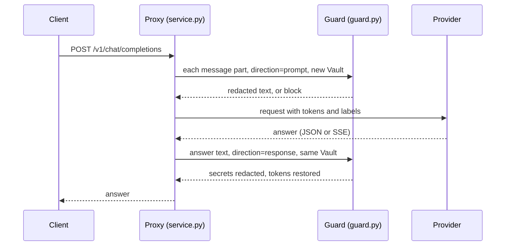

# Architecture

## Request path

## Modules

| Module | Role |
|---|---|
| `catalog.py` | 29 patterns (7 PII, 22 secret) with anchors, validators, capture groups and openers |
| `validators.py`, `rust/src/validators.rs` | Luhn, IBAN, IPv4/IPv6 ranges, JWT, GitHub checksum, SSN, phone digit count, entropy |
| `rust/src/engine.rs` | Aho-Corasick prefilter, regex matching from an offset, validation, char offsets |
| `rust/src/finding.rs` | Byte to char offsets, overlap resolution |
| `rust/src/tokenize.rs`, `rust/src/crf.rs` | Tokenizer, 19 hashed features per token, CRF training (AdaGrad, parallel gradients), Viterbi, marginals, model file |
| `rust/src/detector.rs` | Patterns plus tagger, batch scanning with rayon |
| `reference.py` | The same algorithms in Python (`re`, numpy) for parity tests |
| `detector.py` | Backend selection, `Detector` and `Tagger` |
| `policy.py` | Rules, allowlists, custom and disabled patterns; YAML or JSON |
| `vault.py` | Format-preserving tokens, restoration |
| `guard.py` | Policy decisions and redaction for one text and direction |
| `streaming.py` | `StreamRedactor` and `SSEStream` |
| `service.py`, `observability.py` | HTTP service and proxy, Prometheus metrics |
| `mock_llm.py` | Local echo model for demos and tests |
| `datasets.py`, `metrics.py`, `secrets_corpus.py` | Evaluation data and scoring |

## Offsets and characters

The Rust core works on UTF-8 bytes and converts every offset to code points before it returns,
so Python slices `text[start:end]` directly. Word characters (for `\b` and the tokenizer) follow
Rust's Unicode definitions; Python's agree except for combining marks, other numbers (`¼`),
connector punctuation other than `_`, zero-width joiners, circled Latin letters and code points
newer than Python's Unicode database.

## Streaming

See [ADR-0006](adr/0006-exact-streaming.md). For each chunk: append to the buffer; compute
`safe = len - window`, pull it back to the first opener of a long pattern within its maximum
length, then to the start of any candidate match or vault token that crosses it; scan from the
last cut with two characters of context; apply the policy to the released prefix.

## Tagger file format

`DLPCRF01` magic, a little-endian u32 header length, a JSON header (`labels`, `n_buckets`), the
start, end and transition weights as f32, then a u64 row count and `(u32 bucket, f32 x tags)`
rows for the non-zero emission rows. `ReferenceCrf.load` reads the same file with numpy.
